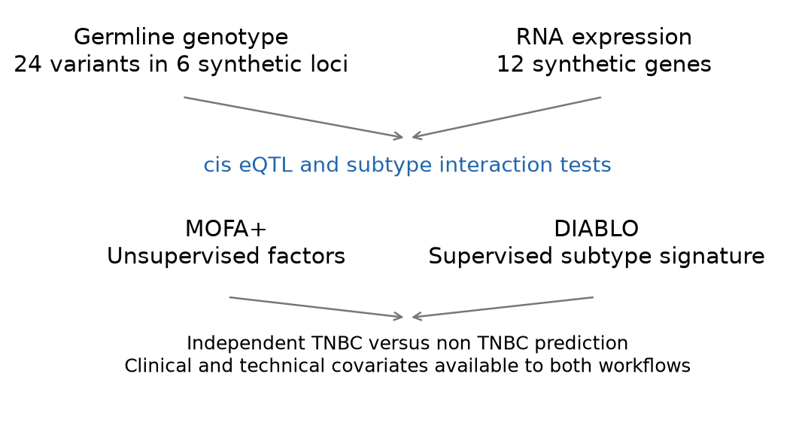
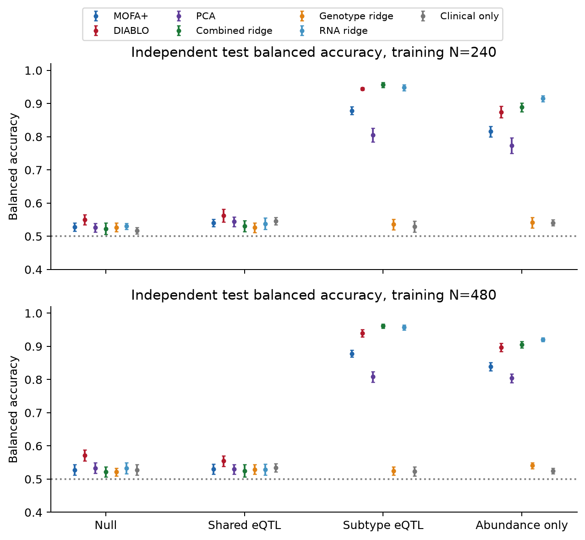
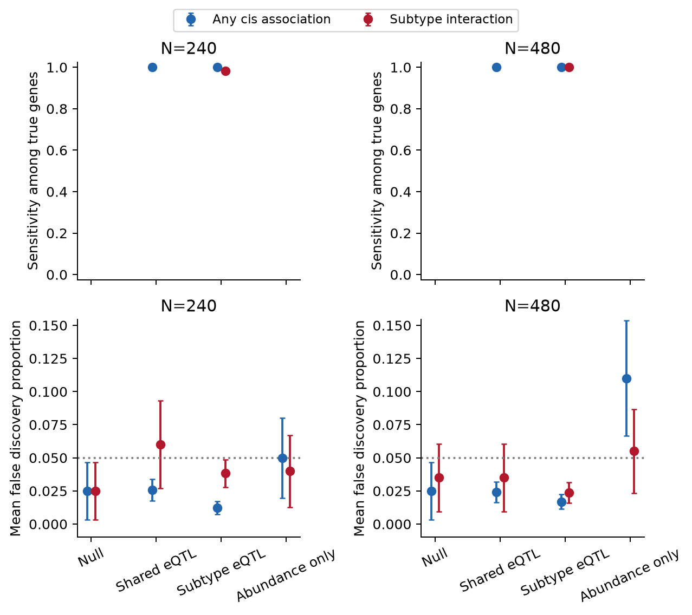
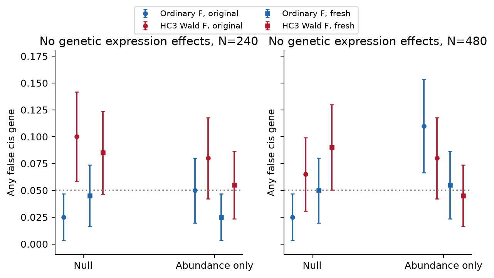
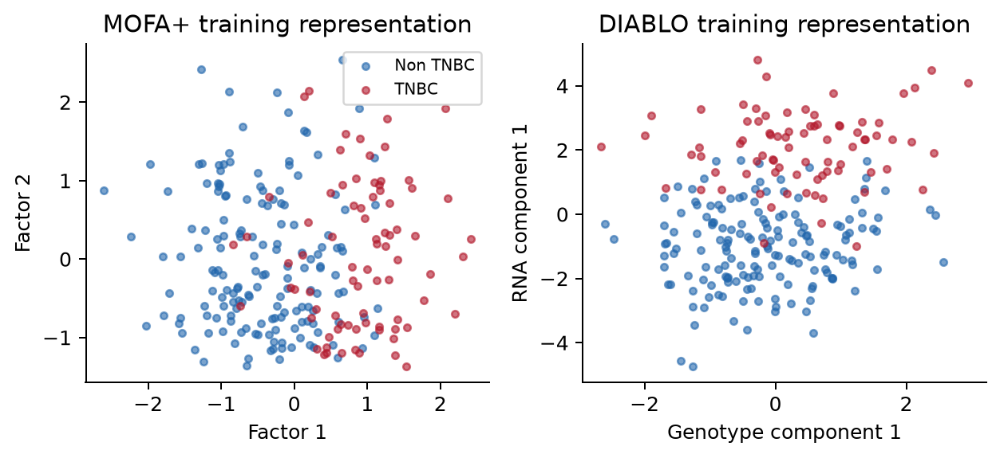
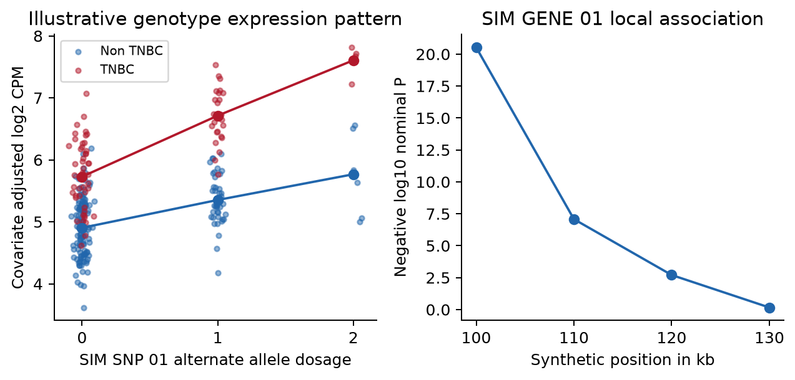
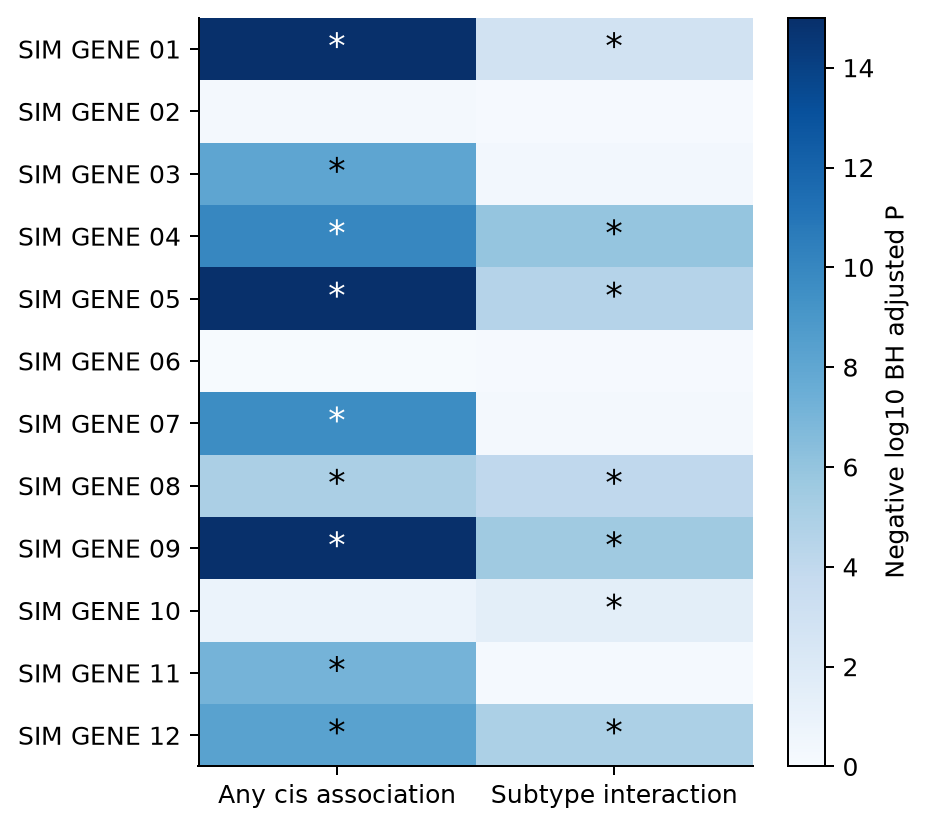

# Genotype and RNA Integration and cis eQTL Mapping in Simulated Breast Cancer

**Vusumuzi Mabasa**

**Simulation study.** All participants, genomic positions, LD, gene identifiers, RNA measurements and TNBC labels are synthetic. This is a design illustration for Study 3 of a proposed breast cancer PhD, not a real breast cancer eQTL discovery study. The current experiment contains germline genotype and RNA only. Protein, somatic alteration and copula models are excluded from this experiment.

[Word report](v3/report/Genotype_RNA_eQTL_Report.docx) · [Quarto source](v3/report/manuscript.qmd) · [Small example dataset](v3/data/example) · [Protocol](v3/protocol/design.json) · [Full workflow](workflow.txt) · [Preserved previous study](https://github.com/Vusumuzi2Mabasa/Breast-Multiomics-Copula-MOFA/blob/80d755b/README.md)

<!-- manuscript -->
## Abstract

We evaluated how germline genotype and RNA measurements could support molecular integration, breast cancer subtype classification and local genetic association mapping in a manageable simulation. Four scenarios separated absent molecular subtype effects, shared cis-eQTLs, subtype-dependent cis-eQTLs with abundance shifts, and abundance shifts without cis-eQTLs. The experiment used 1,600 independently generated eQTL cohorts and 80 independent training/test comparisons at training sizes of 240 and 480. Official MOFA+ and DIABLO implementations were compared with molecular and clinical ridge baselines. A separate gene-level analysis tested local genotype main effects and genotype by subtype interactions, with multiplicity adjustment within each hypothesis family. An elevated false-discovery control cell prompted a disclosed HC3 sensitivity analysis and 800 additional fresh null cohorts; the original results remain preserved. At N = 480 in the subtype-eQTL scenario, independent-test balanced accuracy was 0.878 for MOFA+, 0.940 for DIABLO and 0.961 for the combined ridge baseline. These endpoints answer different questions from eQTL mapping. The study illustrates a reproducible analysis design; it does not identify biomarkers, prove genetic mediation or estimate breast cancer susceptibility.

## Introduction

Study 3 concerns integrating molecular measurements to characterise differences between TNBC and other breast cancer subtypes. Restricting the molecular layers to germline genotype and RNA makes the genetic association question explicit: are local variants associated with expression, and do their associations differ between subtypes? This question can be addressed alongside molecular programme discovery and subtype prediction without requiring protein measurements.

MOFA+ models shared and view-specific variation without using subtype labels during factor fitting [1,2]. DIABLO learns a supervised multiblock signature using those labels [3,4]. Neither latent factor separation nor successful classification establishes an eQTL. Local genotype–expression association therefore requires a separate analysis with its own covariate model, hypotheses and multiplicity control. The GTEx framework provides an established example of tissue-aware regulatory association mapping [5].

The present simulation uses blood-like bulk RNA abundance and case-only subtype labels. It does not use mammary tissue, actual patient material, tumour mutation calls or real breast cancer gene annotations. Its synthetic gene names deliberately avoid presenting invented associations for actual breast cancer genes. It provides a transparent example of what an analysis could look like before assay availability, sample size, ancestry and clinical details are finalised.

## Methods

### Experimental design and preservation

The previous published experiment at commit 80d755b is preserved. Its sources, scientific results, figures and Word report remain unchanged, and its README and workflow are archived under v3/baseline. New experiment sources and outputs are confined to v3; the repository landing README and workflow describe the current experiment. Scientific source hashes were frozen after a dedicated development pilot and before the repeated evaluation runs.

Table 1. Independent simulation components. Different methods within one replicate share the same participants and test outcomes.

| Component | Specification | Scope |
| --- | --- | --- |
| Molecular layers | 24 germline dosages and 12 RNA genes | No protein or somatic layer |
| Participants | 240 or 480 training cases | 360 independent test cases |
| eQTL evaluation | 4 scenarios × 2 sizes × 200 | 1,600 cohorts |
| Integration evaluation | 4 scenarios × 2 sizes × 10 | 80 training and test pairs |
| Genetic regions | 6 synthetic loci with 4 variants each | 2 mapped genes per locus |



Figure 1. Genotype and RNA support local eQTL mapping, unsupervised MOFA+ and supervised DIABLO. The diagram describes statistical analyses, not an established causal pathway.

### Synthetic participants and local genetic structure

Each cohort represented breast cancer cases with a simulated TNBC indicator. Age, cellular composition, three ancestry strata and three batches were generated independently at the participant level except for prespecified ancestry-dependent allele frequencies. Each of six local regions contained four correlated variants. Latent Gaussian correlation between variants a and b was $0.65^{|a-b|}$; inverse-binomial thresholds generated 0, 1 or 2 alternate allele dosages. Allele frequencies varied approximately between 0.18 and 0.40 before modest ancestry shifts. This supplies synthetic LD, not an empirical African or other population reference.

Subtype sampling followed

$$
\Pr(T_i=1\mid G_i,C_i)=\operatorname{expit}\{-0.65+0.30A_i+0.25F_i+0.20I(S_i=2)+0.25(G_{i1}-2p_1)\},
$$

where A is standardised age, F is standardised cell fraction, S is synthetic ancestry and T denotes TNBC. The model defines a case-only subtype contrast. It does not compare cases with healthy controls or estimate genetic susceptibility to breast cancer.

### RNA abundance and known eQTL truth

Two genes were assigned to each synthetic region. Their RNA abundance depended on clinical and technical covariates, three shared residual programmes and gene-specific noise. The latent log2 abundance was

$$
L_{ig}=5+C_i^\top\eta+H_i^\top w_g+\beta_gG_{iv(g)}+\gamma_gT_i+\delta_gG_{iv(g)}T_i+\epsilon_{ig},
$$

with $H_i\sim N_3(0,I)$, one loading of 0.25 per gene and $\epsilon_{ig}\sim N(0,0.35^2)$. Each gene had a prespecified local causal variant. In shared-eQTL settings, six genes had $\beta_g=0.45$. In subtype-eQTL settings, six genes additionally had positive or negative $\delta_g=0.65$ in magnitude, giving nine genes with any genetic effect. Six genes also had subtype abundance shifts of 0.65. The abundance-only setting retained those mean shifts with all genetic expression effects zero. The null setting had neither genetic expression effects nor direct subtype abundance shifts; subtype still depended on the stated clinical and genotype inputs.

Counts were generated using the known simulated whole-assay library size $s_i$:

$$
K_{ig}\sim\operatorname{NB}(\mu_{ig},r=30),\quad \mu_{ig}=\frac{s_i}{10^6}2^{L_{ig}},\quad \operatorname{Var}(K_{ig}\mid L,s)=\mu_{ig}+\frac{\mu_{ig}^2}{30},
$$

$$
Y_{ig}=\log_2\left(10^6K_{ig}/s_i+1\right).
$$

These are small selected RNA panels, not simulated complete transcriptomes. Known whole-assay libraries avoid incorrectly normalising by the sum of only twelve genes. Linear eQTL models were fitted to Y; the log transformation and count noise make their coefficients working observed-expression effects rather than exact estimates of every latent L coefficient.

### Quality checks

The workflow checks allele dosage validity, finite measurements, count integrality, positive library sizes, sample alignment and gene/variant dimensions. The released example includes explicit sample identifiers, covariates, library sizes, a variant map and a separate simulation truth table. These are analysis-ready synthetic matrices; FASTQ alignment, variant calling and imputation were not performed.

Minor allele frequencies and within-ancestry Hardy–Weinberg summaries are descriptive. The Pearson approximation is reported only where all expected genotype counts are at least five. Small ancestry strata are flagged where that approximation is unsuitable; phenotype-dependent genotype filtering is not applied. Relatedness, sample swaps, real genotype uncertainty and sequencing artefacts require additional QC in the actual study.

### MOFA and supervised comparison

Both molecular views were adjusted for known synthetic ancestry and batch using training participants only, then standardised with training quantities. Subtype labels were excluded from this preparation and from MOFA factor fitting. The official mofapy2 engine used Gaussian working likelihoods for standardised dosage and log RNA views; this approximates discrete dosages and is not a binomial genotype likelihood.

For each view m, the factor model was

$$
X^{(m)}=ZW^{(m)\top}+E^{(m)}.
$$

Factor budgets 2, 4 and 6 were selected using 15% masked entries in both training views. Masked entries were excluded from preprocessing fits; validation loss averaged the two standardised view errors with equal weight. Two genuinely distinct starts, PCA and perturbed PCA, were compared by training ELBO. The selected factor budget was refitted on complete training views. Its Gaussian posterior-mean score projection was applied consistently to training and independent test participants:

$$
\widehat z_i=(I+W^\top\Lambda W)^{-1}W^\top\Lambda x_i.
$$

MOFA factors entered an L2-penalised logistic classifier with fixed C = 1 and the observed clinical covariates. PCA used the MOFA-selected factor budget. Genotype-only, RNA-only and combined-view ridge classifiers used the same clinical inputs, training-only scaling and fixed penalty. A clinical-only classifier was an additional reference. Their outputs are complete workflow comparisons, not evidence that one representation is universally optimal.

Official R mixOmics DIABLO used the genotype and RNA molecular blocks plus an additional observed clinical-input block. This supplies the same clinical information available to the downstream ridge classifiers; it does not add a third molecular assay. Threefold stratified training-only validation selected one or two components and four or eight features per block, limited by available features. Covariate preparation was repeated inside each fold. Weighted centroid voting supplied class predictions. DIABLO was evaluated by balanced accuracy; hard labels were not treated as calibrated probabilities or used to manufacture ROC curves.

All final classifiers were evaluated on 360 independent test participants per replicate. MOFA and ridge workflows additionally supplied ROC AUC and Brier scores. Ten independent replicates per scenario and sample size describe Monte Carlo variability, not clinical validation. All selected-fit convergence flags remain in the primary results.

### Gene level cis eQTL tests

For each gene, the four variants in its local synthetic region were modelled jointly:

$$
Y_{ig}=\alpha_g+C_i^\top\theta_g+\tau_gT_i+\sum_{v\in\mathcal C_g}b_{gv}G_{iv}+\sum_{v\in\mathcal C_g}d_{gv}G_{iv}T_i+e_{ig}.
$$

Age, cellular composition, known ancestry and batch were included as covariates. Molecular factors learned from the same expression matrix were not automatically included, since they could absorb the genetic signal of interest. The primary omnibus test compared this full model with a model containing only the covariates and subtype:

$$
H_{0g}^{\mathrm{cis}}:\quad b_{gv}=d_{gv}=0\quad\text{for every }v\in\mathcal C_g.
$$

The separate interaction test compared the full model with one retaining common genotype effects but omitting interactions:

$$
H_{0g}^{\mathrm{interaction}}:\quad d_{gv}=0\quad\text{for every }v\in\mathcal C_g.
$$

Nested-model F statistics used the observed design ranks:

$$
F_g=\frac{(\mathrm{RSS}_0-\mathrm{RSS}_1)/(r_1-r_0)}{\mathrm{RSS}_1/(n-r_1)}.
$$

The nominal F reference assumes a correctly specified Gaussian linear model with homoscedastic errors. Count transformation makes this a working approximation; its realised error rates were assessed through the repeated null and abundance-only simulations rather than asserted to be exact. Genotype by subtype interaction tests assess differences directly; significance in one subtype and non-significance in another is not such a test.

Benjamini–Hochberg adjustment was applied separately to twelve gene-level omnibus P values and twelve interaction P values within each cohort. For ordered P values, the adjusted values were

$$
q_{(j)}=\min\left\{1,\min_{k\ge j}\frac{12p_{(k)}}{k}\right\}.
$$

The two families were not jointly controlled. Dependence assumptions and model approximation remain relevant, so empirical mean false discovery proportions are reported. Sensitivity used the known gene-level truth. An LD-correlated tag association was not called a false causal discovery: these tests identify a gene-level regional association, not the causal nucleotide. No fine-mapping, colocalisation, mediation or pQTL analysis was performed.

### Variance robustness and fresh negative controls

The original abundance-only N = 480 omnibus cell showed realised FDR of 0.110. After observing this result, an explicit protocol amendment added HC3 covariance estimates on the unchanged gene models and 800 fresh null/abundance-only cohorts, 200 per scenario and sample size. The sensitivity implementation and new seed bank were frozen before those fresh cohorts were evaluated. No original effect sizes, seeds, thresholds or results were replaced.

For design matrix X, residuals e and leverage h, HC3 used

$$
\widehat V_{\mathrm{HC3}}=(X^\top X)^{-1}X^\top\operatorname{diag}\left\{\frac{e_i^2}{(1-h_i)^2}\right\}X(X^\top X)^{-1}.
$$

For the q tested coefficients, the Wald quantity divided by q was compared with an approximate F distribution using q and n minus the design rank degrees of freedom. BH was applied separately within the same twelve-gene families. This is a variance-robust sensitivity analysis, not exact finite-sample calibration or a correction for every possible mean-model error.

## Results

### An inspectable study example

The released example was fixed before evaluation at 240 cases in the subtype-eQTL setting. It contains both subtype groups, local genotype variation and count-derived RNA measurements. Table 2 records its principal QC checks. Perfect call rate reflects the synthetic generator and should not be expected in actual samples.

Table 2. QC of the prespecified small example. Ancestry-specific HWE details are supplied in the results directory.

| Check | Result |
| --- | --- |
| Genotype call rate | 100.0% |
| Minimum observed minor allele frequency | 0.142 |
| Valid allele dosages | 24 of 24 variants |
| Finite RNA measurements | 12 of 12 genes |
| Valid counts and positive library sizes | Passed |
| TNBC and non TNBC cases | 79 and 161 |
| Protein features | 0 |

### Integration and independent subtype prediction

MOFA and DIABLO answered different fitting questions but were evaluated against the same independent subtype outcomes. Table 3 reports balanced accuracy at N = 480. The combined and single-view baselines show whether any apparent gain comes from integration, RNA abundance differences or clinical information. The null and shared-eQTL settings need not permit chance-level prediction, because subtype sampling already depends on observed clinical variables and one genotype.

Table 3. Mean independent-test balanced accuracy across ten replicates per scenario at training N = 480.

| Scenario | MOFA | DIABLO | Combined ridge | RNA ridge | Clinical only |
| --- | --- | --- | --- | --- | --- |
| Null | 0.528 | 0.572 | 0.522 | 0.533 | 0.528 |
| Shared eQTL | 0.530 | 0.555 | 0.525 | 0.529 | 0.534 |
| Subtype eQTL | 0.878 | 0.940 | 0.961 | 0.957 | 0.524 |
| Abundance only | 0.839 | 0.897 | 0.905 | 0.920 | 0.525 |

Across the 80 integration replicates, 0 selected-fit diagnostic flags were retained. No flagged fit was silently excluded to improve the comparison. DIABLO has access to subtype labels during representation learning, whereas MOFA does not. Differences therefore compare complete unsupervised-plus-classifier and supervised workflows, not equal learning objectives.



Figure 2. Mean balanced accuracy with approximate 95% Monte Carlo intervals across ten independent replicates. The dotted line is 0.5. Error bars describe simulation variability, not patient-level uncertainty in a clinical deployment.

Probability-based evaluation supplies an additional view for the workflows that produce probabilities. Table 4 intentionally omits DIABLO because its released output is a voted class. AUC should be interpreted together with balanced accuracy, Brier scores in the numerical tables and the simple references.

Table 4. Mean independent-test ROC AUC at training N = 480.

| Scenario | MOFA | PCA | Combined ridge | Genotype ridge | RNA ridge | Clinical only |
| --- | --- | --- | --- | --- | --- | --- |
| Null | 0.587 | 0.586 | 0.562 | 0.564 | 0.589 | 0.600 |
| Shared eQTL | 0.588 | 0.587 | 0.566 | 0.573 | 0.581 | 0.599 |
| Subtype eQTL | 0.957 | 0.903 | 0.994 | 0.562 | 0.991 | 0.579 |
| Abundance only | 0.931 | 0.897 | 0.970 | 0.577 | 0.978 | 0.602 |

### Genetic association and subtype interactions

The eQTL analysis addressed regional genotype–expression associations independently of classifier performance. Shared-eQTL cohorts contained six true cis-associated genes and no true subtype interactions. Subtype-eQTL cohorts contained nine true cis-associated genes and six interaction genes. Null and abundance-only cohorts contained no true cis associations. Table 5 therefore separates sensitivity where an alternative exists from false discoveries in every setting.

Table 5. Gene-level detection and realised false discovery proportion at N = 480 across 200 independent cohorts per scenario. FDP is zero when no genes are selected; its mean estimates realised FDR under this generator. An undefined sensitivity is shown as not applicable.

| Scenario | Test family | Sensitivity | Mean FDP | Mean discoveries |
| --- | --- | --- | --- | --- |
| Null | Any cis association | Not applicable | 0.025 | 0.03 |
| Null | Subtype interaction | Not applicable | 0.035 | 0.04 |
| Shared eQTL | Any cis association | 1.000 | 0.024 | 6.17 |
| Shared eQTL | Subtype interaction | Not applicable | 0.035 | 0.04 |
| Subtype eQTL | Any cis association | 1.000 | 0.017 | 9.17 |
| Subtype eQTL | Subtype interaction | 1.000 | 0.024 | 6.17 |
| Abundance only | Any cis association | Not applicable | 0.110 | 0.13 |
| Abundance only | Subtype interaction | Not applicable | 0.055 | 0.07 |

For the complete null at N = 240, realised mean FDP was 0.025 for the omnibus family and 0.025 for interactions. Corresponding N = 480 values were 0.025 and 0.035. These are empirical estimates from 200 cohorts each. They do not establish universal FDR control, and this twelve-gene panel does not reproduce the multiplicity burden of a transcriptome-wide eQTL scan.



Figure 3. Sensitivity and mean FDP for the two separately adjusted gene families. Missing sensitivity points correspond to settings without true alternatives. Error bars are approximate 95% Monte Carlo intervals; the lower-panel dotted line is 0.05.

### The negative controls qualify eQTL interpretation

The original abundance-only N = 480 omnibus false-discovery probability was 0.110, compared with 0.080 for HC3 on those same cohorts. Thus HC3 did not remove the elevated point estimate in that bank. In the separately seeded fresh abundance-only bank, corresponding values were 0.055 and 0.045. The fresh results provide additional evidence but do not erase the original control failure or establish universal error control. HC3 also increased omnibus rejection in the null setting: at N = 240 the original and fresh values were 0.100 and 0.085, and the fresh N = 480 value was 0.090. Consequently HC3 is not a validated default replacement; neither set of checks certifies the workflow for confirmatory eQTL inference without further calibration.

Table 6. False-discovery probabilities in the abundance-only negative control. Each entry uses 200 cohorts. Every gene is null for genetic association here, so mean FDP equals the probability of selecting any gene.

| Bank | Method | Cis N240 | Cis N480 | Interaction N240 | Interaction N480 |
| --- | --- | --- | --- | --- | --- |
| original | Ordinary F | 0.050 | 0.110 | 0.040 | 0.055 |
| original | HC3 Wald F | 0.080 | 0.080 | 0.045 | 0.040 |
| fresh | Ordinary F | 0.025 | 0.055 | 0.025 | 0.050 |
| fresh | HC3 Wald F | 0.055 | 0.045 | 0.035 | 0.045 |



Figure 4. Original and fresh negative-control omnibus error rates with approximate 95% Monte Carlo intervals. Circles show original cohorts and squares show fresh cohorts; the dotted line is 0.05. Ordinary F and HC3 results are both retained. These estimates qualify the mapping workflow rather than certify transcriptome-wide calibration.

### Molecular representations and an illustrative locus

The prespecified training cohort provides an inspectable representation of both methods. MOFA factors summarise variation; DIABLO components are constructed using subtype labels. Visual separation in these training plots is therefore descriptive and cannot replace the independent-test results above.



Figure 5. MOFA factor scores and DIABLO genotype/RNA component scores for the same 240 training cases. These axes have different meanings and are not directly comparable effect scales. The figure is a training visualisation, not external validation.

The first synthetic locus illustrates how genotype dosage, subtype and expression can be examined together. The local association panel contains only four synthetic variants; it is not a genome-wide Manhattan plot. A correlated lead variant can tag the planted genetic signal without identifying the causal allele.



Figure 6. SIM GENE 01 expression after adjustment for measured covariates, with genotype-group means by subtype, and nominal local tag-association P values. The abundance shift and subtype-specific slope were deliberately planted; they are not findings about a named breast cancer gene.

Table 7 shows all twelve genes in the prespecified example, including non-significant genes and the separate truth labels. The small example can miss planted signals or select null genes. The repeated simulation bank supplies the performance evidence; this single cohort was not selected for an attractive result.

Table 7. Example gene-level BH-adjusted P values from the preserved ordinary F analysis. Truth labels are available only because these data are simulated; the negative-control limitations above also apply.

| Synthetic gene | Cis q | Interaction q | True cis effect | True interaction |
| --- | --- | --- | --- | --- |
| SIM GENE 01 | 2.31e-19 | 0.00145 | Yes | Yes |
| SIM GENE 02 | 0.521 | 0.719 | No | No |
| SIM GENE 03 | 8.77e-09 | 0.431 | Yes | No |
| SIM GENE 04 | 1.08e-10 | 1.15e-06 | Yes | Yes |
| SIM GENE 05 | 5.7e-18 | 3.03e-05 | Yes | Yes |
| SIM GENE 06 | 0.863 | 0.719 | No | No |
| SIM GENE 07 | 2.26e-10 | 0.509 | Yes | No |
| SIM GENE 08 | 9.38e-06 | 9.32e-05 | Yes | Yes |
| SIM GENE 09 | 1.08e-18 | 3.09e-06 | Yes | Yes |
| SIM GENE 10 | 0.126 | 0.0318 | No | No |
| SIM GENE 11 | 7.95e-08 | 0.656 | Yes | No |
| SIM GENE 12 | 5.02e-09 | 1.07e-05 | Yes | Yes |



Figure 7. Omnibus and interaction adjusted P values from the preserved ordinary F analysis for all twelve example genes. Asterisks mark q below 0.05 within each separately adjusted family. Colours show negative log10 q, capped at 15, and do not establish causal regulation.

## Discussion

This experiment provides a more explicit genetic anchor for Study 3 than a generic comparison of integration algorithms. MOFA discovers major molecular patterns, DIABLO evaluates a supervised subtype signature, and cis-eQTL tests examine local genetic associations with RNA. A useful expression signature need not contain eQTL genes, and an eQTL can be shared across subtypes without improving classification. Agreement between these analyses would be informative, but disagreement is not inherently a failure.

The subtype-eQTL scenario intentionally combines genetic interaction and mean abundance differences. Its classification results cannot isolate the contribution of interactions. Shared-eQTL and abundance-only controls help separate these ingredients, but further factorial simulations would be needed to quantify their individual predictive contributions. The independent test sets assess performance under the same generating population, not transport to a new clinical cohort or ancestry.

Real-data interpretation requires additional safeguards. Blood RNA can reflect immune composition, treatment, disease consequences and sampling conditions rather than tumour-specific regulation. Germline genotypes must come from a defensible assay, with ancestry, relatedness, imputation and variant QC addressed. A cell-composition estimate is measured imperfectly in practice; the simulation uses the true generated covariate. Subtype-associated selection among breast cancer cases can also complicate causal interpretation. None of the models proves that an expression change causes TNBC.

The simulation is deliberately small: six local regions, twelve genes, common variants, idealised ancestry adjustment and ten integration replicates per cell. LD is synthetic. There are no rare-variant burdens, real breast cancer risk loci, empirical African reference haplotypes, copy-number changes, longitudinal treatment effects, missing assays or independent biological replication. Strong planted effects and a twelve-gene testing family make this unsuitable as a definitive PhD sample-size calculation. Small-panel power must not be extrapolated to tens of thousands of genes.

The eQTL F tests use a working linear model on transformed counts. The original abundance-only error excess remains a limitation despite the more reassuring fresh controls. HC3 can address variance misspecification but cannot certify the mean model or finite-sample calibration. More realistic studies should assess count-model sensitivity, expression confounding, genotype uncertainty and alternative covariate specifications. Statistical association does not identify the causal variant or establish a mediation chain. Colocalisation with external breast cancer GWAS would require actual harmonised regional summary statistics, ancestry-appropriate LD and explicit assumptions; it is not supplied by the current simulation. Public tissue-specific eQTL resources can provide context but cannot be labelled as a replication in the proposed clinical cohort [5,6].

## Conclusion

A genotype-and-RNA Study 3 can combine programme discovery, subtype prediction and direct local genetic association mapping while keeping their scientific questions separate. The present workflow supplies tested code, an inspectable small dataset and repeated performance estimates for that design. Negative-control excesses show that the current eQTL testing references need further calibration before confirmatory use. It is a simulated methods illustration, not a clinical biomarker or breast cancer susceptibility discovery study.

## Reproducibility

The scientific source lock, raw replicate records, full numerical summaries, independent R checks, example QC, figures and manuscript sources are released under v3. The original two published experiments remain available in their existing directories and archived READMEs. The main Word report is authored by Vusumuzi Mabasa and generated from the same research text with editable equations and native tables.

```bash
python -m venv .venv
source .venv/bin/activate
python -m pip install -r requirements.txt
export OPENBLAS_NUM_THREADS=1 OMP_NUM_THREADS=1 MKL_NUM_THREADS=1
python -m unittest discover -s v3/tests -v
python v3/src/run.py --stage eqtl --workers 2
python v3/src/run.py --stage integration --workers 2
Rscript --vanilla v3/src/diablo.R .
python v3/src/replay_integration.py
python v3/src/analysis.py
Rscript --vanilla v3/src/check_R.R .
python v3/src/robustness.py
Rscript --vanilla v3/src/check_HC3.R .
python v3/src/figures.py
python v3/src/manuscript.py
python v3/src/build_word.py
python v3/src/audit.py --fresh
```

R with mixOmics and jsonlite, Python with the pinned requirements, and Quarto are required. The commands resume existing records; use the fresh-run wrapper and a new output directory to regenerate all cohorts without replacing released results. Detailed Toshiba and Linux commands are in workflow.txt. Independent R checks validate QR-based eQTL P values, BH adjustment and held-out probability metrics. All DIABLO voted-class metrics are checked against the common released test outcomes.

## References

1. Argelaguet R, et al. MOFA+: a statistical framework for comprehensive integration of multi-modal single-cell data. Genome Biology. 2020;21:111. [Methods paper](https://doi.org/10.1186/s13059-020-02015-1).
2. MOFA developers. [Official preprocessing and interpretation guidance](https://biofam.github.io/MOFA2/faq.html).
3. Singh A, et al. DIABLO: an integrative approach for identifying key molecular drivers from multi-omics assays. Bioinformatics. 2019;35:3055–3062. [Methods paper](https://doi.org/10.1093/bioinformatics/bty1054).
4. mixOmics developers. [Official DIABLO documentation](https://mixomics.org/mixdiablo/).
5. GTEx Consortium. The GTEx Consortium atlas of genetic regulatory effects across human tissues. Science. 2020;369:1318–1330. [Research article](https://pmc.ncbi.nlm.nih.gov/articles/PMC7737656/).
6. EMBL-EBI. [eQTL Catalogue](https://www.ebi.ac.uk/eqtl/).

## Data and code availability

All released observations and genomic annotations in this experiment are synthetic. No patient data, private proposal documents, controlled-access genotypes or external eQTL summary statistics are included. Code, simulation results and reports are available in [the public repository](https://github.com/Vusumuzi2Mabasa/Breast-Multiomics-Copula-MOFA) under the existing licence. Earlier protein-containing experiments remain preserved as historical analyses; they are not input layers to the present workflow.
